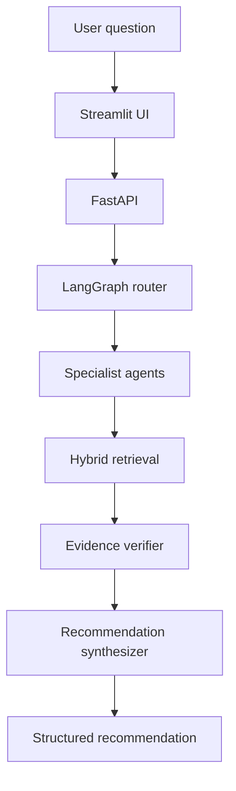

# Agentic AI Management Consulting Platform

> A local-first, evidence-grounded consulting assistant that routes enterprise questions to specialized agents and produces structured recommendations.


## Overview

This CMPE 256 hackathon project implements a zero-cost, local Agentic AI Management Consulting Platform. It combines agent routing, hybrid retrieval, evidence verification, and recommendation synthesis to answer enterprise questions with traceable supporting evidence.

The platform is designed around four specialist domains:

- **Technology** — technology strategy and engineering questions
- **SEC** — filings, financial disclosures, and public-company evidence
- **Clinical** — clinical and healthcare-related information
- **Corporate Responsibility** — sustainability, ethics, and responsibility topics

All specialists use a shared local Ollama model, helping keep the prototype private, reproducible, and independent of paid cloud APIs.

## Key Capabilities

- Routes questions to the most relevant specialist agent through LangGraph
- Retrieves evidence using Chroma vector search and SQLite FTS5 keyword search
- Combines semantic and lexical retrieval in a hybrid pipeline
- Verifies retrieved evidence before recommendation generation
- Produces structured, evidence-grounded consulting recommendations
- Exposes a FastAPI backend and Streamlit interface
- Includes automated tests for core workflows

## Architecture



### Reasoning Flow

1. The user submits an enterprise question through the Streamlit interface.
2. FastAPI passes the request to the LangGraph manager/router.
3. The router selects one or more specialist agents.
4. Chroma and SQLite FTS5 retrieve supporting evidence.
5. The evidence verifier checks the retrieved context.
6. The recommendation synthesizer produces the final structured response.

## Technology Stack

| Layer | Technologies |
| --- | --- |
| Language | Python 3.11 |
| Agent orchestration | LangGraph |
| Local inference | Ollama |
| API | FastAPI |
| User interface | Streamlit |
| Vector retrieval | Chroma |
| Keyword retrieval | SQLite FTS5 |
| Data validation | Pydantic |
| Testing | pytest |

### Local Models

- `qwen2.5:7b` — local language model
- `nomic-embed-text` — embedding model

## Indexed Data

| Domain | Indexed Chunks |
| --- | ---: |
| Technology | 219 |
| SEC | 2,376 |
| Clinical | 14,990 |
| Corporate Responsibility | 1,590 |

## Project Structure

```text
.
├── app/
│   ├── agents/          # Specialist agents
│   ├── api/             # FastAPI application
│   ├── graph/           # LangGraph workflow and routing
│   ├── models/          # Pydantic and domain models
│   ├── recommendation/  # Recommendation synthesis
│   ├── retrieval/       # Chroma and SQLite FTS5 retrieval
│   └── ui/              # Streamlit interface
├── data/                # Domain data and indexes
├── docs/                # Project documentation
├── evaluation/          # Evaluation resources
├── scripts/             # Data preparation and ingestion scripts
├── tests/               # Automated tests
├── requirements.txt
├── START_HERE.md
└── README.md
```

## Getting Started

### Prerequisites

- Python 3.11
- Ollama
- Git

### Install Dependencies

```bash
python -m venv .venv

# Windows
.venv\Scripts\activate

# macOS/Linux
source .venv/bin/activate

pip install -r requirements.txt
```

### Prepare Ollama

```bash
ollama serve
ollama pull qwen2.5:7b
ollama pull nomic-embed-text
```

### Run the Applications

Start the FastAPI service:

```bash
uvicorn app.api.main:app --reload
```

Start the Streamlit interface in a second terminal:

```bash
streamlit run app/ui/streamlit_app.py
```

Use [START_HERE.md](START_HERE.md) for the current project checklist, data-ingestion notes, and validation status.

## Testing

Run the automated test suite with:

```bash
pytest
```

## Team

Built as a CMPE 256 hackathon project by **EliteSquad**:

- Andrew Byi
- Navya Illa
- Praneeth Kalangi
- Arti Ramesh Nalawade
