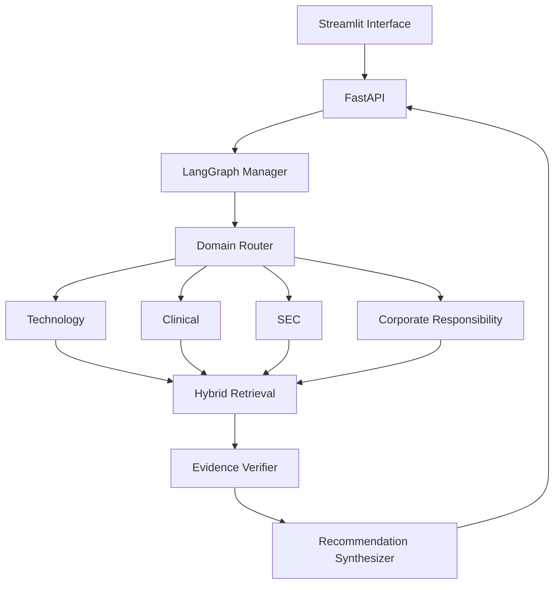

# System Architecture

## Objective

The platform converts an enterprise question into a cited consulting recommendation. It identifies the relevant domains, retrieves evidence from bounded collections, invokes the necessary specialists, verifies support, ranks actions, and returns risks, next steps, and measurable outcomes.

## Logical Flow

## Components

### Streamlit Interface

Collects a customer question and displays:

- Selected agents
- Clarifying questions
- Recommendation
- Evidence and citations
- Uncertainty
- Risks
- Next actions
- Suggested KPIs

### FastAPI

Provides health, query, and evaluation endpoints. It validates requests and responses and separates the demonstration interface from the workflow.

### LangGraph Manager

Owns request state and controls transitions. It should use explicit nodes and conditions rather than an unconstrained autonomous loop.

### Domain Router

Returns a validated decision containing:

- Detected intent
- Relevant domains
- Extracted entities
- Required specialists
- Missing information
- Risk level
- Routing rationale

Use deterministic keyword and entity rules first, followed by structured model classification when needed.

### Specialist Agents

Every specialist receives the same base input and returns the same base report fields:

- Findings
- Evidence IDs
- Retrieval scores
- Assumptions
- Missing information
- Candidate recommendations
- Risks
- Confidence components
- Domain-specific fields

The agent configuration supplies its domain instructions, allowed tools, collection, filters, and output extensions.

### Retrieval

1. Parse PDF, text, and CSV sources.
2. Create page-aware or record-aware chunks.
3. Attach source metadata.
4. Create embeddings.
5. Store chunks in domain-separated Chroma collections.
6. Index normalized text in SQLite FTS5.
7. Search both indexes with mandatory domain filters.
8. Fuse and rerank results.
9. Return evidence packets with stable IDs.

### Evidence Verifier

Checks whether recommendations are supported by retrieved evidence. It rejects missing, contradictory, or cross-domain-contaminated citations.

### Recommendation Synthesizer

Ranks candidate actions using:

- Evidence relevance
- Source quality
- Compatibility or applicability
- Feasibility
- Risk
- Expected impact
- Implementation effort

The final response contains recommendation, evidence, uncertainty, risks, next actions, and KPIs.

## Shared Model Strategy

All agents share one Ollama model. Agent count does not equal model count.

- Start with a quantized 7B-14B instruction model.
- Use an 8K-16K context initially.
- Run one generation at a time during development.
- Test a maximum of two parallel specialist requests before enabling concurrency.
- Retrieve focused chunks instead of placing complete PDFs in the prompt.

## State Model

The graph state should include:

- Request ID
- User question
- Extracted entities
- Selected domains
- Clarification status
- Specialist reports
- Evidence packets
- Verification result
- Ranked recommendations
- Final response
- Errors and retries
- Timing metrics

## Observability

Record:

- Workflow node and transition
- Routing result
- Retrieval query and evidence IDs
- Retrieval scores
- Model and embedding identifiers
- Prompt version identifier
- Validation retry count
- Latency
- Verification outcome
- Evaluation result

Do not log credentials, personal data, or hidden chain-of-thought.

## Future Evolution

After the hackathon, the same contracts can support managed model APIs, Azure AI Foundry, Microsoft Agent Framework, managed vector search, OpenTelemetry export, authentication, and independently deployed services. These are not initial requirements.

